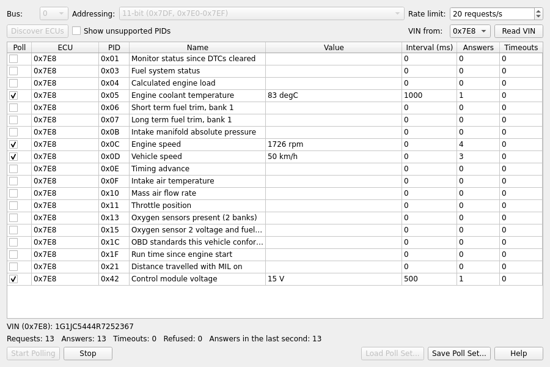

OBD-II Poller
=============

Send Frames > OBD-II Poller asks a vehicle's ECUs for OBD-II values (engine speed, vehicle speed, temperatures,
battery voltage and so on) over and over, and shows the answers. The requests and the answers go into the capture
like any other traffic, so a log saved while polling holds them next to whatever else was captured, for example
another bus you're logging at the same time.

The poller only reads. It sends nothing but Mode 01 (current data) and Mode 09 (vehicle information) requests: it
never clears fault codes or sends anything that changes the vehicle.

Before You Start
================

- **Connect to the OBD port's CAN bus** (pins 6 and 14), usually at 500 kbit/s, and open the connection in
  SavvyCAN.
- **Listen-only must be off** for that bus, or no request can be sent. The window warns when it's on.
- **Two adapters?** If the OBD bus and the other bus you're logging are on different adapters, each adapter stamps
  its own frames. Pick "Use system clock" in the preferences so both buses share one time base and their frames line
  up in the log.

Using the Window
================

1. **Bus and addressing.** Pick the bus the OBD port is on. Most vehicles use **11-bit** addressing (requests to
   0x7DF, answers from 0x7E8 to 0x7EF); some newer ones and many trucks use **29-bit** (0x18DB33F1 and 0x18DAF1xx).
2. **Discover ECUs.** SavvyCAN asks every ECU which PIDs it supports. The table then lists, for each ECU that
   answered, the PIDs it supports. "Show unsupported PIDs" lists the rest too. Before discovery (or if nothing
   answers) the table lists every PID, sent to all ECUs at once.
3. **Tick the PIDs to poll** in the Poll column. "Interval (ms)" is the time between two requests for that PID; 0
   asks for it as often as the other ticked PIDs and the rate limit allow. A slow-changing value such as the
   coolant temperature can have 1000 ms or more, so the fast ones get more of the bus.
4. **Start Polling.** The Value column shows each PID's latest value; Answers and Timeouts count the replies and the
   requests that got none. Stop ends polling, and so does closing the window.
5. **Read VIN** asks the ECU picked next to it for the vehicle identification number.

The line below the table counts requests, answers, timeouts and refusals (negative replies), and how many answers
came in during the last second.

**Rate limit:** the poller sends one request at a time, and the next only after the answer or a 50 ms wait. The rate
limit (20 requests a second by default) caps how often that happens. Many vehicles answer through a gateway that only
manages 10 to 30 answers a second in all, so asking for more PIDs makes each one slower rather than adding load.

**Refused PIDs:** when an ECU answers that it doesn't support a PID, the Value column says so and that PID isn't
asked for again from that ECU.

Poll Sets
=========

Save Poll Set... writes the bus, addressing, rate limit and the ticked PIDs (with their intervals) to an `.obd` file;
Load Poll Set... ticks them again. A poll set made for one vehicle works on another as long as its ECUs use the same
addresses; PIDs a vehicle doesn't support are refused and then skipped.

Graphing the Values
===================

The answers are ordinary CAN frames in the capture (0x7E8 and so on), so the graph window can plot them once a DBC
file describes them. Building that DBC file from the poller is the next step of this feature.

Things to Know
==============

- **Gateways:** some vehicles only answer OBD-II requests with the ignition on, and some (many EVs) answer only a
  few Mode 01 PIDs; their other values need manufacturer-specific requests, which the poller doesn't send yet.
- **Answers to all ECUs:** a PID ticked in an "All" row is sent to every ECU, and the poller waits the full 50 ms for
  all of them to answer. The Value column then shows which ECU answered last.
- **Timing:** an answer arrives a few milliseconds after the ECU measured the value. Next to the time between two
  requests for the same PID that's usually small.
